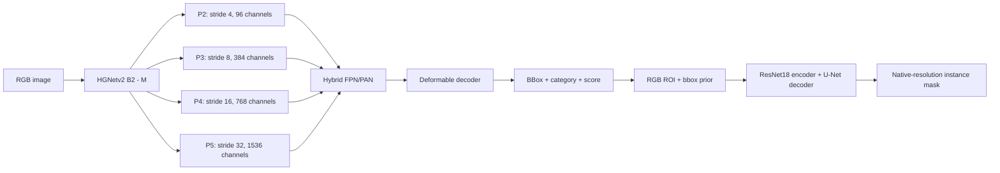

# RT-DETRv4 + Instance Segmentation

## Kiến trúc

Pipeline hai giai đoạn: detector dự đoán bbox/category/score, sau đó mask head dự đoán instance mask trên từng RGB ROI và bbox prior. Detector và mask head được train riêng.



- Detector mặc định dùng RT-DETRv4-M với weights COCO `weights/rtv4_m_coco.pth` và backbone HGNetv2 B2. `--model-size s` chọn lại bản S/B0 cho `setup-detector`, `fit`, `train-detector`; weights và kiến trúc phải cùng kích cỡ.
- Detector hỗ trợ P3–P5 hoặc P2–P5 với `--p2`. Bản bốn mức dùng stride `[4,8,16,32]`, sampling point `[3,3,6,3]`; chuyển checkpoint giữ đúng thứ tự các feature level cũ. Kênh P2–P5 của M là `[96,384,768,1536]`, S là `[64,256,512,1024]`.
- Mask head có `tiny` và `resnet18_unet`. ResNet18 dùng encoder pretrained, skip đa tỉ lệ và nhánh detail ở độ phân giải đầy đủ. Input gồm RGB và bbox prior; LR encoder bằng 0,1 lần decoder.
- AMP bật mặc định khi train trên CUDA; loss tính float32. Mask inference dùng autocast trên CUDA. `train --no-amp` tắt AMP của mask head.
- COCO polygon/RLE có sẵn được dùng trực tiếp; bbox-only dùng pseudo-mask. `--fill-mode convex` dành cho vật thể gần lồi; `holes` giữ các vùng lõm ngoài đường bao.
- `--padding` là context crop. `--mask-overflow` là giới hạn mask vượt bbox mỗi phía theo tỷ lệ width/height; không ép mask tô kín vùng này. Hai giá trị được lưu trong checkpoint.
- Bundle lưu config, hai checkpoint, label map và ngưỡng mask. Inference trả COCO RLE ở kích thước ảnh gốc, overlay và CSV diện tích/đường kính tương đương theo pixel.

## Cách chạy

### Cài đặt

Cần Python 3.11–3.13 và `uv`; GPU dùng driver tương thích CUDA 12.8. Dự án dùng PyTorch 2.9.1 / torchvision 0.24.1 (CUDA 12.8), hỗ trợ GPU Blackwell.

```bash
uv sync --frozen --extra dev --extra detector
source .venv/bin/activate
detrseg setup-detector --model-size m
detrseg --help
```

`setup-detector` tải checkout upstream đã pin và checkpoint pretrained, kiểm tra checksum. `vendor/` cần được giữ lại khi inference. Có thể dùng `.venv/bin/detrseg` thay cho activate môi trường; `--device cpu` chạy không có GPU.

Nếu tải dependencies bị timeout, chạy lại `UV_HTTP_TIMEOUT=600 UV_HTTP_RETRIES=5 uv sync --frozen --extra dev --extra detector`. Cache đã tải được sẽ được dùng lại. Lockfile lấy Torch/torchvision từ index CUDA 12.8 của PyTorch, còn các gói `nvidia-*` từ PyPI để tránh phụ thuộc nguồn `pypi.nvidia.com`.

Có thể dùng môi trường train Python 3.12 riêng để giữ môi trường cũ, hoặc tận dụng wheel Python 3.12 đã có trong cache:

```bash
UV_PROJECT_ENVIRONMENT=.venv-train UV_HTTP_TIMEOUT=600 UV_HTTP_RETRIES=5 \
  uv sync --frozen --extra dev --extra detector --python 3.12
source .venv-train/bin/activate
```

Khi dùng môi trường này, thay `.venv/bin/python`/`.venv/bin/detrseg` trong các lệnh bằng `.venv-train/bin/python`/`.venv-train/bin/detrseg`. Lệnh `detrseg` sau khi activate cũng dùng đúng môi trường.

### Chuẩn bị dữ liệu

COCO phải có `images`, `annotations`, `categories`; `--images` trỏ tới gốc tương ứng với `images[].file_name`. Bbox theo `xywh` ở tọa độ ảnh gốc.

```bash
# Nếu đầu vào là CVAT XML:
detrseg convert-cvat --xml dataset/annotations.xml \
  --images dataset/images --output dataset/annotations.json

detrseg audit --annotations dataset/annotations.json --images dataset/images
```

Để tách train/validation theo ảnh gốc, video hoặc phiên chụp, dùng JSON group map, ví dụ `{"0":"capture_A","1":"capture_A","2":"capture_B"}`, rồi truyền `--groups dataset/groups.json` cho `fit`/`prepare`. Mỗi image ID phải có group; cần ít nhất hai group.

Gộp hai nhãn COCO `ball` (ID 1) và `caculated_ball` (ID 2) thành `ball` (ID 1):

```bash
python3 scripts/merge_coco_labels.py \
  --input dataset/annotations/instances_default.json \
  --output dataset/annotations/instances_ball.json \
  --source-ids 1 2 --target-id 1 --name ball
```

Script chỉ cần Python, giữ nguyên ảnh, bbox, segmentation và số đối tượng; không ghi đè file gốc hoặc output đã tồn tại. Dùng file `instances_ball.json` cho `--annotations` khi prepare/train. Có thể đổi tên/ID đích bằng `--name` và `--target-id`. Nếu bỏ `--source-ids`, input phải có đúng hai nhãn; nếu có nhãn khác ngoài cặp được chọn, chúng được giữ lại.

### Xuất 100 crop ROI để sửa mask COCO

Mỗi crop chứa annotation của một đối tượng đã có bbox. Script chọn tối đa 100 đối tượng, lấy luân phiên giữa các ảnh gốc để mẫu không tập trung vào ảnh nhiều bbox. Chỉ khi bạn chạy lệnh, script mới đọc annotation và ảnh được chỉ định; không có đường dẫn dataset mặc định.

```bash
.venv-train/bin/python scripts/export_seg_coco.py \
  --annotations dataset/annotations/instances_ball.json \
  --images dataset/images/default \
  --output reports/seg_review_100 \
  --mode roi --count 100 --seed 42 --padding 0.25 \
  --mask-checkpoint runs/m_ball_20261029_094330/mask/best.pt \
  --device cpu --zip
```

Mask có sẵn được giữ trước; đối tượng chỉ có bbox sẽ nhận mask nháp từ checkpoint mask head. Có thể bỏ `--mask-checkpoint` để tạo pseudo-mask từ bbox. Trường hợp không tạo được mask, script vẫn giữ đối tượng bằng hình chữ nhật `bbox_placeholder` để bạn vẽ lại. Không chạy detector hoặc tìm các đối tượng chưa gán nhãn.

Kết quả nằm trong `reports/seg_review_100/`, kèm `reports/seg_review_100.zip`:

- `images/default/roi_*.png`: các crop có context quanh bbox.
- `annotations/instances_default.json`: COCO instance segmentation, tọa độ mask/bbox theo crop.
- `review.csv`: nguồn ảnh, ID annotation, tọa độ crop trên ảnh gốc, nguồn mask và lý do dùng placeholder.
- `report.json`: số lượng và thống kê nguồn mask.

Tạo task bằng các crop trong `images/default`, rồi import `annotations/instances_default.json` theo COCO 1.0 để sửa mask. Mặc định xuất polygon; mask có lỗ dùng RLE để giữ nguyên hình học. Tất cả mask đều được đánh dấu `pending`, cần kiểm tra và sửa trước khi dùng làm ground truth. ROI chỉ có annotation của đối tượng được chọn, kể cả khi context chứa đối tượng khác. Sau khi sửa, xuất COCO instance segmentation để train phần seg; giữ `review.csv` để truy ngược về ảnh gốc. Script không ghi đè output đã tồn tại. `--mode images` là tùy chọn xuất ảnh gốc cùng toàn bộ annotation hiện có nếu cần sau này.

### Hai dataset riêng cho detector và segmentation

Ví dụ `final_v1_102926.zip` chứa COCO detection và `acf_seg_v1.zip` chứa COCO instance segmentation. Giải nén mỗi ZIP vào thư mục riêng, rồi xuất split 80/20 thành các file và thư mục ảnh dưới `dataset/sub_dataset`. Các lệnh bên dưới để người dùng chạy; không cần đọc dataset để cấu hình script.

```bash
mkdir -p dataset/unpacked
raw_dir="$(mktemp -d "$PWD/dataset/unpacked/train_v1.XXXXXX")"
unzip dataset/final_v1_102926.zip -d "$raw_dir/det"
unzip dataset/acf_seg_v1.zip -d "$raw_dir/seg"

.venv-train/bin/python scripts/split_coco.py \
  --dataset "$raw_dir/det" --task det \
  --output dataset/sub_dataset/det --val-fraction 0.2 --seed 42

.venv-train/bin/python scripts/split_coco.py \
  --dataset "$raw_dir/seg" --task seg \
  --output dataset/sub_dataset/seg --val-fraction 0.2 --seed 42
```

Mỗi thư mục `det`/`seg` có `train/images`, `train/annotations/instances_default.json`, `val/images`, `val/annotations/instances_default.json`. COCO tổng nằm tại `annotations/instances_default.json` và dùng `file_name` tương đối từ thư mục `det`/`seg`. `split_report.json` lưu split theo image ID để train giữ nguyên. Script copy ảnh, giữ nhãn và không ghi đè output đã có dữ liệu. Với seg, mọi annotation phải có mask; bbox-only sẽ báo lỗi. Hai bộ giữ label riêng, không gộp chung.

Split dựa trên ảnh/group nguồn, đồng thời giữ các file ảnh giống hệt nhau trong cùng split. Với ROI đã mất metadata nguồn khi xuất từ CVAT, thêm `--review-csv reports/seg_review_100/review.csv` vào lệnh split seg nếu đó là CSV tương ứng; hoặc dùng `--groups path/to/groups.json` cho ảnh cùng video/phiên chụp. Không có mapping nguồn thì script chỉ xác định được từng ảnh crop và các file trùng hệt.

Train detector M/P2 với weights COCO M và mask head ResNet18 U-Net với nhãn seg riêng:

```bash
train_run="runs/final_v1_$(date +%Y%m%d_%H%M%S)"
.venv-train/bin/detrseg setup-detector --model-size m
.venv-train/bin/detrseg train-detector \
  --annotations dataset/sub_dataset/det/annotations/instances_default.json \
  --images dataset/sub_dataset/det \
  --split-report dataset/sub_dataset/det/split_report.json \
  --output "${train_run:?Set train_run before training}/detector" --model-size m --p2 \
  --steps 3000 --batch-size 4 --size 640 --lr 0.0002 \
  --val-every 250 --budget-seconds 7200 --device cuda

.venv-train/bin/python scripts/train_seg_coco.py \
  --dataset dataset/sub_dataset/seg --output "${train_run:?Set train_run before training}/seg" \
  --architecture resnet18_unet --size 192 \
  --steps 1000 --batch-size 16 --lr 0.0003 \
  --budget-seconds 3600 --device cuda
```

Script seg tự tìm JSON/ảnh, dùng mask COCO hiện có, tự nhận `split_report.json` và không chia lại. Mặc định encoder ResNet18 dùng weights ImageNet (cần tải nếu chưa cache). Thêm `--initial-checkpoint path/to/mask/best.pt` để fine-tune mask head cùng kiến trúc; khi đó không tải encoder. `--prepare-only` chỉ tạo cache. Checkpoint tốt nhất nằm tại `$train_run/detector/best.pt` và `$train_run/seg/mask/best.pt`. Bước train nào hết budget có thể dừng trước số steps được yêu cầu.

### Theo dõi train bằng MLflow

Client MLflow là dependency tùy chọn, cài một lần vào môi trường train:

```bash
uv pip install --python .venv-train/bin/python "mlflow-skinny>=2.17,<4"
```

Điền URL server một lần, sau đó dùng nguyên các lệnh train det/seg ở trên:

```bash
export MLFLOW_TRACKING_URI="http://YOUR_MLFLOW_HOST:5000"
```

Cũng có thể truyền `--mlflow-uri http://YOUR_MLFLOW_HOST:5000` trực tiếp cho `detrseg train`, `detrseg train-detector`, `detrseg fit` và `scripts/train_seg_coco.py`; giá trị dòng lệnh ưu tiên hơn biến môi trường. Mặc định tạo experiment `DETRv4-Seg`, mỗi lần train có một run riêng với tag `task=det` hoặc `task=seg`. `--mlflow-experiment`, `--mlflow-run-name` và `--mlflow-log-every` cho phép đổi tên/chu kỳ; mặc định ghi loss ở step đầu, mỗi 20 step và step cuối. Với `fit`, tên run tùy chỉnh nhận thêm hậu tố `-det`/`-seg`. Có thể đặt experiment chung bằng `MLFLOW_EXPERIMENT_NAME`. Cấu hình server dùng [MLflow Tracking API](https://mlflow.org/docs/latest/ml/tracking/tracking-api/).

MLflow nhận tham số train, cấu hình model/device, learning rate và train loss; det thêm các loss thành phần và validation AP/AP50, seg thêm validation loss/IoU/Dice. Validation được ghi theo `--val-every`, kèm kết quả tốt nhất, số step, thời gian và peak VRAM cuối run. Run được kết thúc với trạng thái `FINISHED`, `FAILED` hoặc `KILLED` khi ngắt bằng bàn phím. Link và ID run nằm trong `mlflow.json` cạnh checkpoint. Các file dữ liệu và checkpoint vẫn lưu tại output local; tracking ghi parameters/metrics, không phụ thuộc cấu hình artifact storage của server.

Khi bật MLflow, kết nối ban đầu phải thành công trước khi bắt đầu train. Loss theo step được gửi bất đồng bộ. **Sau mỗi validation**, train chờ gửi xong các metrics đang đợi và gửi đồng bộ toàn bộ `val/*`, `best/*`, `best/step` lên server trước khi tiếp tục; không chờ cuối run. Lỗi gửi trong lúc train được báo trên terminal, training và checkpoint local tiếp tục. Khi không có URL dòng lệnh hoặc biến môi trường, training chạy như cũ và không cần cài MLflow. Thay đổi này áp dụng khi khởi động tiến trình train mới; tiến trình Python đang chạy vẫn giữ code đã nạp.

### Thử S + P2 và Tiny U-Net cho ROI 20–30 px

Xem [EXPERIMENT_S_P2_TINY.md](EXPERIMENT_S_P2_TINY.md) cho nhánh thử nghiệm riêng: detector S/P2 một class, Tiny U-Net nhận ROI native không resample, lệnh xuất thêm 500 ROI để review và controls ẩn/hiện overlay theo loại hoặc từng instance. Các model hiện có vẫn được hỗ trợ; chưa có bước chọn model/deploy tự động.

### Train toàn pipeline

```bash
detrseg fit \
  --annotations dataset/annotations.json --images dataset/images \
  --output runs/experiment --model-size m --p2 --mask-architecture resnet18_unet \
  --groups dataset/groups.json \
  --padding 0.25 --mask-overflow 0.25 --fill-mode convex \
  --detector-steps 3000 --mask-steps 1000 \
  --detector-size 640 --detector-batch-size 4 \
  --budget-seconds 1800 --device cuda
```

Bỏ `--p2` để dùng ba mức. Chọn `--fill-mode holes` cho vật thể có vùng lõm thật. `--mask-overflow 0` giới hạn mask trong bbox; overflow không được lớn hơn context padding. Budget kiểm tra giữa các bước, không ngắt kernel/validation đang chạy. Thư mục output phải mới hoặc trống.

### So sánh S và M

Chạy cùng dữ liệu, split, seed, input size, batch size, số bước và tùy chọn P2; chỉ đổi kích cỡ model và thư mục output. Tăng budget đủ để cả hai hoàn thành số bước yêu cầu, vì cùng thời gian có thể cho số bước khác nhau.

```bash
detrseg setup-detector --model-size s
detrseg setup-detector --model-size m

for model in s m; do
  detrseg train-detector \
    --annotations dataset/annotations.json --images dataset/images \
    --split-report runs/experiment/cache/report.json \
    --model-size "$model" --output "runs/compare_${model}" --p2 \
    --steps 3000 --size 640 --batch-size 4 --seed 42 \
    --budget-seconds 7200 --device cuda
done
```

So sánh `best_AP`, số bước thực tế, thời gian train và peak VRAM trong `detector/summary.json` (hoặc `summary.json` với `train-detector`). `fit` còn ghi `metrics.json` gồm bbox AP và mask AP. Mask AP với pseudo-mask chỉ đo độ khớp nhãn tự sinh. Checkpoint và summary mới lưu `model_size` để phân biệt các lần chạy.

### Fine-tune detector

Checkpoint S cũ cần `--model-size s`. Bắt đầu thử M bằng weights COCO M; checkpoint S không tương thích với kiến trúc M.

```bash
detrseg train-detector \
  --annotations dataset/annotations.json --images dataset/images \
  --split-report runs/experiment/cache/report.json \
  --pretrained runs/experiment/detector/best.pt \
  --output runs/detector_tuned --model-size m --p2 \
  --steps 4000 --lr 0.0001 --val-every 250 --patience 6 \
  --budget-seconds 1200 --device cuda
```

Checkpoint P2 cần `--p2` khi train tiếp. `--pretrained` nạp weights với optimizer mới, không phải resume optimizer. `--ema-decay 0.99` bật EMA; mặc định tắt. `--patience 0` tắt early stopping. Split report phải khớp các image ID của dataset hiện tại; không dùng split cũ trực tiếp với tập đã thêm ảnh.

### Train hoặc fine-tune mask head

```bash
detrseg prepare \
  --annotations dataset/annotations.json --images dataset/images \
  --groups dataset/groups.json --output runs/masks/cache \
  --padding 0.25 --mask-overflow 0.25 --fill-mode convex

detrseg train --cache runs/masks/cache --output runs/masks/train \
  --architecture resnet18_unet --steps 1000 --batch-size 16 --device cuda

detrseg train --cache runs/masks/cache --output runs/masks/tuned \
  --architecture resnet18_unet --initial-checkpoint runs/masks/train/best.pt \
  --steps 3000 --lr 0.0003 --device cuda
```

`prepare` giữ mask gán sẵn và lưu cache. Khi muốn giữ nguyên pseudo-mask đã chấp nhận, dùng COCO có `segmentation` cùng metadata `mask_source` làm input, tránh tạo lại nhãn từ bbox-only. `--grabcut` bật refinement tùy chọn.

### Ghép checkpoint và inference

```bash
detrseg bundle \
  --config runs/detector_tuned/config.yml \
  --detector-checkpoint runs/detector_tuned/best.pt \
  --label-map runs/detector_tuned/label_map.json \
  --mask-checkpoint runs/masks/tuned/best.pt \
  --annotations dataset/annotations.json \
  --output runs/deploy/bundle.json --mask-threshold 0.5

detrseg predict --bundle runs/deploy/bundle.json \
  --input dataset/images --output runs/predictions \
  --device cuda --score-threshold 0.5
```

`--input` nhận một ảnh hoặc thư mục. `--mask-threshold` override ngưỡng trong bundle; `--no-overlays` chỉ xuất dữ liệu. Output gồm `instances.json`, `images.json`, `measurements.csv`, `summary.json`, `overlays/`. Detection score không phải xác suất mask đúng. Đường kính CSV tính từ diện tích mask theo pixel, chưa hiệu chuẩn sang đơn vị vật lý.

### App PyQt6: ONNX Runtime + vòng tròn + Diameter

Chạy từ thư mục `DETRv4-Seg`. App có môi trường riêng, không cần PyTorch để inference:

```bash
uv venv .venv-viewer --python 3.12
uv pip install --python .venv-viewer/bin/python -r onnx_viewer/requirements.txt
.venv-viewer/bin/python -m onnx_viewer
```

Chọn **Model / manifest** (`detector.onnx` hoặc `manifest.json`), **Open image folder**, rồi **Infer current** hoặc **Infer folder**. Ảnh có contour, vòng tròn `C1`, `C2`… và `D=… px`; bảng bên dưới hiển thị label, score, tâm và Diameter. Có Previous/Next, chỉnh score/mask threshold, Stop và **Save results** để xuất overlay PNG cùng `measurements.csv`. Inference chạy trong worker thread. CPU là mặc định; CUDA xuất hiện nếu môi trường ONNX Runtime có CUDA provider. Bộ requirements trên cài bản CPU.

Hai khung **Original** và **Inference** hiển thị cạnh nhau. Cuộn chuột hoặc bấm **+ / −** để zoom, giữ chuột trái kéo để pan; thao tác ở một khung được đồng bộ sang khung kia. **Fit** hoặc nhấp đúp để vừa khung, **1:1** để một pixel ảnh bằng một pixel hiển thị. Kết quả inference giữ nguyên zoom/vị trí đang xem; chuyển ảnh mới tự Fit. Zoom chỉ thay cách hiển thị, Diameter vẫn tính theo pixel ảnh gốc.

Trong **Inference**, **Diameter (hover)** hiển thị một ô nhỏ `C1 · Ø 20.30 px` khi rê chuột vào instance, thay cho chữ vẽ vào ảnh preview; cỡ chữ không đổi theo zoom. Giữ chuột trái trên instance để tạm ẩn overlay, thả ra để hiện lại; kéo chuột vẫn pan. Trỏ vào instance rồi nhấn **H** để giữ ẩn trên ảnh đó trong phiên làm việc. **Show all instances** hoặc checkbox **Show** khôi phục; infer lại reset trạng thái ẩn. Việc ẩn và xem Diameter dùng kết quả đã cache, không thay phép đo hoặc chạy infer lại.

Đường kính là `2 × radius` từ `cv2.minEnclosingCircle(contour)` trong tọa độ ảnh gốc, khác với đường kính tương đương từ diện tích trong pipeline CLI. Khi có mask ONNX, contour lấy từ mask sau hậu xử lý giống pipeline PyTorch. Detector-only dùng Otsu trong ROI và ghi nguồn `ROI Otsu (detector only)`; không lấy đường chéo bbox làm đường kính. Không tìm thấy contour thì D hiện `N/A`. Đơn vị là pixel; app chưa hiệu chuẩn sang µm/mm.

Export **bundle đã train** của DETRv4-Seg sang detector + mask ONNX:

```bash
# Trong môi trường đã cài dependencies train/detector:
uv pip install --python .venv-train/bin/python -r onnx_viewer/requirements-export.txt
.venv-train/bin/python scripts/export_onnx_bundle.py \
  --bundle runs/deploy/bundle.json --output runs/deploy/onnx
```

Sau đó chọn `runs/deploy/onnx/manifest.json` trong app; mask, kích thước ROI, padding, overflow và label map được đọc tự động. Export kiểm tra ONNX graph và so sánh đầu ra với PyTorch trên input mẫu trước khi ghi manifest. Thư mục output phải mới hoặc trống. ONNX cố định batch 1 và input size theo checkpoint; viewer xử lý lần lượt từng ảnh.

Nếu train det và seg bằng hai dataset riêng, export trực tiếp từ hai run. Thay các timestamp dưới đây bằng thư mục output tương ứng:

```bash
.venv-train/bin/python scripts/export_onnx_bundle.py \
  --detector-dir runs/det_m_YYYYMMDD_HHMMSS \
  --mask-checkpoint runs/seg_YYYYMMDD_HHMMSS/mask/best.pt \
  --output runs/onnx_test_v2
```

Chế độ này tự tạo `runs/onnx_test_v2/bundle.json` từ config, checkpoint, label map và categories trong `train.json` của detector. Hai graph và manifest nằm tại `runs/onnx_test_v2/onnx/`. Export chạy CPU, so sánh bằng tensor giả và không đọc ảnh. Script không tự chọn run mới nhất để tránh dùng nhầm checkpoint.

App cũng nhận model RT-DETR có đầu ra `logits`/`pred_boxes` hoặc `labels`/`boxes`/`scores` của upstream. Bundle v9 trong `../quant_models/v9_fp32/` được đọc đúng preprocessing letterbox qua `manifest.json`. ONNX tùy biến cần giữ đúng hợp đồng này; mask riêng cần input `[1,4,H,W]` (RGB/255 + bbox prior) và output logits `[1,1,H,W]`. Với graph detector có kích thước động, ô Input chọn kích thước; graph cố định dùng kích thước có sẵn. Bản Windows dùng `.venv-viewer/Scripts/python.exe` thay cho `.venv-viewer/bin/python`.

Gộp app, hai model ONNX và 3 ảnh test thành ZIP để chuyển sang máy khác:

```bash
python3 scripts/package_onnx_viewer.py \
  --model-dir runs/m_ball_20261029_094330/onnx \
  --images-root dataset/images/default \
  --output artifacts/DETRv4-Seg-ONNX-test.zip
```

Giải nén toàn bộ gói trên máy có Python 3.12, rồi Linux chạy `bash run_linux.sh` (Windows dùng `run_windows.bat`). Lần đầu cần Internet để cài dependencies; các lần sau dùng lại môi trường của gói. App tự chọn model đi kèm; mở `sample_images` hoặc thư mục ảnh của bạn. Gói chỉ chứa code inference, model và ảnh mẫu; không cần repo train hay PyTorch. Có `--check` để kiểm tra model không mở GUI và `--verify-only` để kiểm tra checksum không cài thư viện.

Cập nhật gói đã giải nén trên máy test Linux bằng rsync. Điền địa chỉ SSH máy train; không copy `.venv` giữa hai máy:

```bash
cd ~/Downloads/DETRv4-Seg-ONNX-test
train_host="gabap@IP_MAY_TRAIN"
rsync -av --exclude '__pycache__/' \
  "${train_host:?Set train_host}:/home/gabap/prj/DETRv4-Seg/onnx_viewer/" ./onnx_viewer/
rsync -av \
  "${train_host:?Set train_host}:/home/gabap/prj/DETRv4-Seg/detrseg/roi.py" ./detrseg/roi.py
rsync -av \
  "${train_host:?Set train_host}:/home/gabap/prj/DETRv4-Seg/runs/onnx_test_v2/onnx/" ./models/
python3 onnx_viewer/portable/update_viewer.py --root . --refresh-models
bash run_linux.sh
```

Updater cập nhật launcher và checksum sau khi bạn chủ động chuyển code/model. Nếu chỉ cập nhật app, bỏ lệnh rsync models và bỏ `--refresh-models`; checksum model/ảnh cũ được giữ nguyên. Launcher tự bootstrap pip khi môi trường `.venv` hiện có thiếu pip.

### Đánh giá và kiểm tra

```bash
detrseg evaluate --annotations runs/masks/cache/instances_masks.json \
  --images dataset/images --checkpoint runs/masks/tuned/best.pt \
  --output runs/evaluation.json --device cuda

detrseg audit-masks --bundle runs/deploy/bundle.json \
  --annotations dataset/annotations.json --images dataset/images \
  --detections runs/detections.json --output reports/mask_audit --device cuda

pytest -q
ruff check .
ruff format --check .
```

`evaluate` dùng bbox annotation; với COCO không có trường `split`, thêm `--split all`. Chỉ số so với pseudo-mask đo độ khớp với nhãn tự sinh. Model selection và ngưỡng inference nên được kiểm tra trên tập validation riêng.

`audit-masks` ghi JSON/CSV kiểm tra độ ổn định khi flip/lệch bbox, phần mask được thêm bởi hậu xử lý và overlap giữa instance. Đây là chẩn đoán chưa hiệu chuẩn, không phải xác suất mask đúng; lệnh không sửa mask/checkpoint hiện có.
