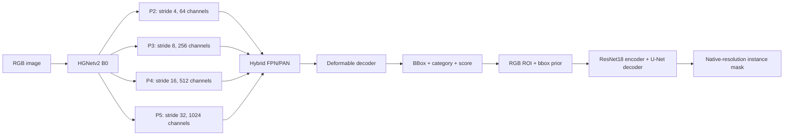

# RT-DETRv4 + Instance Segmentation

## Kiến trúc

Pipeline hai giai đoạn: detector dự đoán bbox/category/score, sau đó mask head dự đoán instance mask trên từng RGB ROI và bbox prior. Detector và mask head được train riêng.



- Detector hỗ trợ P3–P5 hoặc P2–P5 với `--p2`. Bản bốn mức dùng stride `[4,8,16,32]`, sampling point `[3,3,6,3]`; chuyển checkpoint giữ đúng thứ tự các feature level cũ.
- Mask head có `tiny` và `resnet18_unet`. ResNet18 dùng encoder pretrained, skip đa tỉ lệ và nhánh detail ở độ phân giải đầy đủ. Input gồm RGB và bbox prior; LR encoder bằng 0,1 lần decoder.
- AMP bật mặc định khi train trên CUDA; loss tính float32. Mask inference dùng autocast trên CUDA. `train --no-amp` tắt AMP của mask head.
- COCO polygon/RLE có sẵn được dùng trực tiếp; bbox-only dùng pseudo-mask. `--fill-mode convex` dành cho vật thể gần lồi; `holes` giữ các vùng lõm ngoài đường bao.
- `--padding` là context crop. `--mask-overflow` là giới hạn mask vượt bbox mỗi phía theo tỷ lệ width/height; không ép mask tô kín vùng này. Hai giá trị được lưu trong checkpoint.
- Bundle lưu config, hai checkpoint, label map và ngưỡng mask. Inference trả COCO RLE ở kích thước ảnh gốc, overlay và CSV diện tích/đường kính tương đương theo pixel.

## Cách chạy

### Cài đặt

Cần Python 3.11–3.13 và `uv`; GPU dùng driver tương thích CUDA 12.4.

```bash
uv sync --frozen --extra dev --extra detector
source .venv/bin/activate
detrseg setup-detector
detrseg --help
```

`setup-detector` tải checkout upstream đã pin và checkpoint pretrained, kiểm tra checksum. `vendor/` cần được giữ lại khi inference. Có thể dùng `.venv/bin/detrseg` thay cho activate môi trường; `--device cpu` chạy không có GPU.

### Chuẩn bị dữ liệu

COCO phải có `images`, `annotations`, `categories`; `--images` trỏ tới gốc tương ứng với `images[].file_name`. Bbox theo `xywh` ở tọa độ ảnh gốc.

```bash
# Nếu đầu vào là CVAT XML:
detrseg convert-cvat --xml dataset/annotations.xml \
  --images dataset/images --output dataset/annotations.json

detrseg audit --annotations dataset/annotations.json --images dataset/images
```

Để tách train/validation theo ảnh gốc, video hoặc phiên chụp, dùng JSON group map, ví dụ `{"0":"capture_A","1":"capture_A","2":"capture_B"}`, rồi truyền `--groups dataset/groups.json` cho `fit`/`prepare`. Mỗi image ID phải có group; cần ít nhất hai group.

### Train toàn pipeline

```bash
detrseg fit \
  --annotations dataset/annotations.json --images dataset/images \
  --output runs/experiment --p2 --mask-architecture resnet18_unet \
  --groups dataset/groups.json \
  --padding 0.25 --mask-overflow 0.25 --fill-mode convex \
  --detector-steps 3000 --mask-steps 1000 \
  --detector-size 640 --detector-batch-size 4 \
  --budget-seconds 1800 --device cuda
```

Bỏ `--p2` để dùng ba mức. Chọn `--fill-mode holes` cho vật thể có vùng lõm thật. `--mask-overflow 0` giới hạn mask trong bbox; overflow không được lớn hơn context padding. Budget kiểm tra giữa các bước, không ngắt kernel/validation đang chạy. Thư mục output phải mới hoặc trống.

### Fine-tune detector

```bash
detrseg train-detector \
  --annotations dataset/annotations.json --images dataset/images \
  --split-report runs/experiment/cache/report.json \
  --pretrained runs/experiment/detector/best.pt \
  --output runs/detector_tuned --p2 \
  --steps 4000 --lr 0.0001 --val-every 250 --patience 6 \
  --budget-seconds 1200 --device cuda
```

Checkpoint P2 cần `--p2` khi train tiếp. `--pretrained` nạp weights với optimizer mới, không phải resume optimizer. `--ema-decay 0.99` bật EMA; mặc định tắt. `--patience 0` tắt early stopping. Split report phải khớp các image ID của dataset hiện tại; không dùng split cũ trực tiếp với tập đã thêm ảnh.

### Train hoặc fine-tune mask head

```bash
detrseg prepare \
  --annotations dataset/annotations.json --images dataset/images \
  --groups dataset/groups.json --output runs/masks/cache \
  --padding 0.25 --mask-overflow 0.25 --fill-mode convex

detrseg train --cache runs/masks/cache --output runs/masks/train \
  --architecture resnet18_unet --steps 1000 --batch-size 16 --device cuda

detrseg train --cache runs/masks/cache --output runs/masks/tuned \
  --architecture resnet18_unet --initial-checkpoint runs/masks/train/best.pt \
  --steps 3000 --lr 0.0003 --device cuda
```

`prepare` giữ mask gán sẵn và lưu cache. Khi muốn giữ nguyên pseudo-mask đã chấp nhận, dùng COCO có `segmentation` cùng metadata `mask_source` làm input, tránh tạo lại nhãn từ bbox-only. `--grabcut` bật refinement tùy chọn.

### Ghép checkpoint và inference

```bash
detrseg bundle \
  --config runs/detector_tuned/config.yml \
  --detector-checkpoint runs/detector_tuned/best.pt \
  --label-map runs/detector_tuned/label_map.json \
  --mask-checkpoint runs/masks/tuned/best.pt \
  --annotations dataset/annotations.json \
  --output runs/deploy/bundle.json --mask-threshold 0.5

detrseg predict --bundle runs/deploy/bundle.json \
  --input dataset/images --output runs/predictions \
  --device cuda --score-threshold 0.5
```

`--input` nhận một ảnh hoặc thư mục. `--mask-threshold` override ngưỡng trong bundle; `--no-overlays` chỉ xuất dữ liệu. Output gồm `instances.json`, `images.json`, `measurements.csv`, `summary.json`, `overlays/`. Detection score không phải xác suất mask đúng. Đường kính CSV tính từ diện tích mask theo pixel, chưa hiệu chuẩn sang đơn vị vật lý.

### Đánh giá và kiểm tra

```bash
detrseg evaluate --annotations runs/masks/cache/instances_masks.json \
  --images dataset/images --checkpoint runs/masks/tuned/best.pt \
  --output runs/evaluation.json --device cuda

detrseg audit-masks --bundle runs/deploy/bundle.json \
  --annotations dataset/annotations.json --images dataset/images \
  --detections runs/detections.json --output reports/mask_audit --device cuda

pytest -q
ruff check .
ruff format --check .
```

`evaluate` dùng bbox annotation; với COCO không có trường `split`, thêm `--split all`. Chỉ số so với pseudo-mask đo độ khớp với nhãn tự sinh. Model selection và ngưỡng inference nên được kiểm tra trên tập validation riêng.

`audit-masks` ghi JSON/CSV kiểm tra độ ổn định khi flip/lệch bbox, phần mask được thêm bởi hậu xử lý và overlap giữa instance. Đây là chẩn đoán chưa hiệu chuẩn, không phải xác suất mask đúng; lệnh không sửa mask/checkpoint hiện có.
